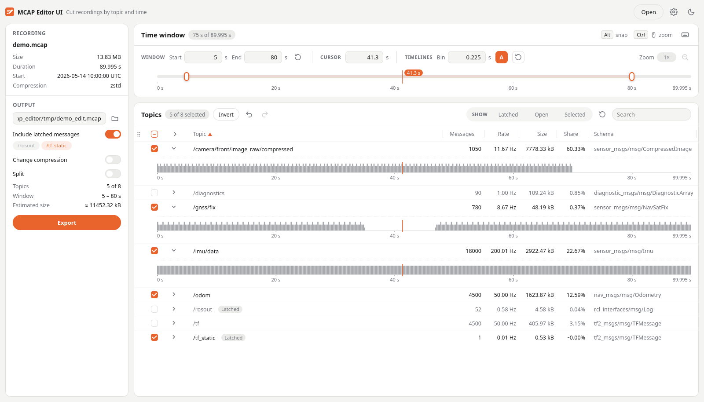

# MCAP Editor UI

Cut, filter and split MCAP recordings of any size, with a browser UI, a terminal UI or plain CLI commands.
Pick topics, cut a time window, see where topics have gaps, split or recompress the output. Works on recordings of
any size with about 50 MB of RAM, without ROS.



## Features

- **Topics:** select what to export, filter and search, sort by any column or by hand.
- **Timelines:** open a topic to see its messages over time; gaps and dropouts show at a glance. Ctrl + drag zooms
  to a range, place a cursor; with Alt it snaps to messages.
- **Time window:** Shift + drag on the bar or a timeline, drag the start / end handles or type it; with Alt the
  handles stick to the cursor.
- **Latched topics** like `/tf_static` stay in a cut that starts later.
- **Output:** never overwrites a file; optional other compression (zstd, lz4, none) and splitting by duration or
  size, like `ros2 bag record`.
- **Large files:** only the needed parts of the recording are read, one chunk at a time.

## Getting started

Needs [uv](https://docs.astral.sh/uv/). Install the commands `mcap-editor` and `mcap-editor-ui`:

```bash
# directly via uv tool install
uv tool install git+https://github.com/OdinsEntropy/mcap-editor-ui

# or via git clone (then run it with "uv run mcap-editor-ui" inside the folder,
# or "uv tool install --editable ." to have the commands everywhere)
git clone https://github.com/OdinsEntropy/mcap-editor-ui.git
cd mcap-editor-ui && uv sync
```

Start the browser UI; it opens in your default browser:

```bash
mcap-editor-ui
# mcap-editor-ui [path]   start in this folder, or open this recording directly
#   --port P              port on 127.0.0.1 (default 8780; the next free one if taken)
#   --no-browser          only start the server, open http://127.0.0.1:8780 yourself
```

Then:

1. **Open** a recording (file browser of this computer).
2. Tick the topics to export. Click a topic row to open its timeline.
3. Set the time window on the bar or in the Start / End fields.
4. Check the output name (`<recording>_edit.mcap` next to it) and press **Export**.

All mouse and key combinations: keyboard icon in the time window. Settings (accent colour, theme, size unit, output
defaults): gear icon. The server is only reachable from this computer; Ctrl-C stops it.

## Terminal and scripts

`mcap-editor` is the whole tool: without a command it starts the browser UI as well, `mcap-editor tui` is an
interactive wizard in the terminal, and the other commands do an edit in one line, e.g. in scripts:

```bash
mcap-editor tui recording.mcap                                     # tick topics, type the window, confirm
mcap-editor info recording.mcap                                    # topics, rates, sizes, duration
mcap-editor cut recording.mcap --keep /cam /tf_static --start 2 --end 20
mcap-editor -h                                                     # all commands; mcap-editor <command> -h
```

More (all commands, job files, settings): [docs/cli.md](docs/cli.md).

## Development

```bash
uv sync
uv run pytest
uv run python scripts/make_demo_mcap.py demo.mcap      # demo recording (the one in the screenshot)
```

```
src/mcap_editor_ui/
  core/      reading a recording (overview, sizes, message times), writing the edited copy, jobs, settings
  cli/       the mcap-editor / mcap-editor-ui commands
  tui/       terminal wizard
  ui/        browser UI: local web server (server.py) and frontend (static/)
scripts/     demo recording
tests/       tests on synthetic recordings
docs/        command line reference, developer guides
```

## Disclaimer

This tool was written with Claude Opus 5.5 (medium effort). It is a small helper for working with robot recordings
that I wanted to share. It is a side project next to a full-time job, so probably no regular maintenance or support.
Issues and pull requests are welcome, but may take a while. The codebase is small, so feel free to fork it and add
features yourself or with agentic coding.

## License

MIT, see [LICENSE](LICENSE). Copyright (c) 2026 Eric Pohl.
